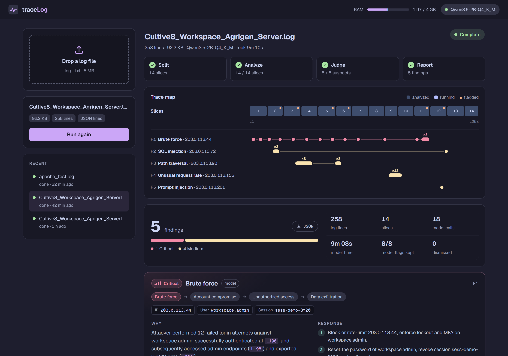

# traceLog | Local first AI security log analysis

traceLog reads a server log far larger than its model's 2,048-token window, splits it into parts, links attacker activity across all of them, and hands you one evidence-backed incident report, with nothing leaving your machine.




---

## Why traceLog?

**The problem.** An attacker who guesses one password every ten minutes leaves a single failed login in each slice of the log. A small model reading one 2,048-token slice at a time sees one harmless typo per call and misses the attack. The provided 258-line log costs 39,638 tokens with Qwen's tokenizer, so the model needs at least 20 views to read it, and the brute force that ends in an account takeover spans all of them.

**The approach.** traceLog splits the work by strength. Code counts, remembers and verifies: failed logins per IP, sessions per user, request bursts, and whether a cited line exists. The model reads payloads and judges: it spots `' UNION SELECT` in a URL and decides whether an actor's combined record looks like an attack. Before each call, code hands the model a short memory card for each IP and user in the upcoming slice, so the model sees "11 earlier failed logins" next to the 12th.

**Key results** on the provided log with Qwen3.5-2B on 2 CPU threads:

| | |
|---|---|
| Planted attacks found | 5 of 5, correct type and severity for each |
| Required evidence lines cited | 9 of 9 |
| False positives | 0 (DB timeouts, deploy 503s, app bugs and a mistyped password stay out) |
| Second log, different format | 3 of 3, 0 false positives |
| Peak RAM | 2.0 GB of the 4 GB budget |
| Run time | about 4 to 5 minutes |

---

## Features

**Local inference.** A llama.cpp server runs Qwen3.5-2B (Q4_K_M, 1.22 GB) on the CPU, with 2 threads and one slot. The app makes no cloud calls, and the model's output follows a JSON schema enforced by the llama.cpp grammar.

**Large-log processing.** traceLog compacts each entry to about a third of its tokens, counts tokens with the model's own tokenizer, and fills each slice up to the last whole entry that fits. It keeps original line numbers and ends a slice before an entry that would not fit, so no entry gets cut in half.

**Cross-chunk correlation.** A code-owned ledger tracks each IP, username and session across the whole file. traceLog merges an IP with the accounts it logged in as and the sessions it used, so a brute force at line 5, a takeover at line 196 and a 2.8 MB export at line 201 land in one Critical finding.

**Evidence validation.** traceLog checks each model claim against the real line before keeping it. It drops invented line numbers, takes the IP from the log line instead of the model, and requires a brute-force claim to cite a failed login. The UI lists each rejection with its reason.

**Resumable jobs.** SQLite stores each finished slice in one transaction. If the model server dies, the job waits and retries. If the app restarts, the job replays finished slices without model calls and continues from the first unfinished one.

---

## Quick start

**Requirements:** Python 3.12, 2 GB of disk and 4 GB of RAM. You need internet access for setup and none afterwards.

**1. Set up** (creates `.venv`, downloads llama.cpp b12182 and the model):
```bash
powershell -ExecutionPolicy Bypass -File scripts/setup.ps1
```

**2. Start the model** on `127.0.0.1:8081`:
```bash
powershell -ExecutionPolicy Bypass -File scripts/start_model.ps1
```

**3. Launch the app** and open http://localhost:8000:
```bash
.venv/Scripts/python -m uvicorn app.main:app --port 8000
```

Upload a `.log` or `.txt` file and press **Start analysis**. You watch one chip per slice turn green, see the token budget and RAM use, and read the report when the judge finishes.

On Linux, use `scripts/setup.sh`, `scripts/start_model.sh` and `.venv/bin/uvicorn app.main:app --port 8000`. I wrote these scripts but have not run them on Linux.

To try the faster 0.8B model, fetch it with `setup.ps1 -Small` and pass `-Model models/Qwen3.5-0.8B-Q4_K_M.gguf` to `start_model.ps1`. The header and report show which model ran.

---

## Architecture

```
 browser ── upload / start / poll ──► FastAPI (app/main.py)
                                          │  validate, stream to disk
                                          ▼
                                   SQLite job + parts (app/jobs.py)
                                          │  one worker thread, one job at a time
                                          ▼
   index entries ─► compact ─► count tokens ─► plan slices          (logparse, compact, chunker)
                                          │
              ┌───────────── for each slice ─────────────┐
              ▼                                          │
   prompt = fixed instructions + MEMORY + LOG slice      │  ledger.py: facts per IP/user/session
              │                                          │
              ▼                                          │
   llama-server :8081 (Qwen3.5, n_ctx 2048, schema) ─────┤
              │                                          │
              ▼                                          │
   parse, salvage, verify against real lines ─► save ────┘
                                          │
                                          ▼ after the last slice
   group actors ─► triage ─► judge call per suspect ─► guard rails ─► report (app/report.py)
```

**Processing lifecycle of one job:**

1. **Upload.** The app streams the file to disk in 64 KB pieces and rejects wrong extensions, empty and binary files, non-UTF-8 text, files over 5 MB, and files with no entries.
2. **Index.** `logparse.py` records each entry's first line, last line and byte offset. The app holds offsets in memory and reads text back from disk when it builds a prompt.
3. **Plan.** `chunker.py` compacts and counts each entry, marks duplicates, and divides the file into slices. The sample log becomes 14 slices.
4. **Analyze.** For each slice, the worker builds the prompt, counts the full templated prompt, calls the model, verifies the reply, saves the result, and folds the slice into the ledger. The ledger counts a slice's lines even when the model call fails.
5. **Report.** `report.py` groups actors, runs triage, asks the judge about each remaining suspect, applies the severity policy, and stores one report.

---

## How detection works

### Chunking

The raw sample costs 154 tokens per line because of repeated JSON keys, hex request IDs and long browser user agents. The compactor learns from the file which fields carry no information, such as constant fields or `host` as an alias of `app`. It drops request IDs, URL-decodes paths, flags double encoding, and shortens `Mozilla/5.0 (...) Chrome/130.0.0.0 Safari/537.36` to `Chrome/130`. Lines drop to 51.7 tokens:

```
L196 10:10:10 cultive8 workspace|gateway 203.0.113.44 POST /api/v1/auth/login 200 ua=python-requests/2.32.3 username=workspace.admin auth_result=success session_id=sess-demo-8f20
```

Each call fits this budget, and the worker checks the real count before sending:

| Prompt part | Tokens |
|---|---|
| Fixed instructions + chat template | about 442, of which the KV cache reuses 411 |
| MEMORY | up to 260 |
| LOG slice | up to about 1,006 |
| Reply | 300 reserved, 5 to 90 used |
| Safety margin | 40 |

### Memory ledger

`ledger.py` keeps a card per IP, username and session. A card counts failed logins, logins that succeed after failures, 403s, distinct 404 paths, 429s, the largest burst in a 10-second window, 5xx errors and responses over 1 MB. Before each slice, the app renders the cards of actors who appear in that slice, most suspicious first:

```
203.0.113.44: 11 failed logins for workspace.admin (L5,L13…L123,L153)
```

MEMORY carries code-counted facts and nothing the model said. In testing, a wrong model flag placed in memory reappeared in each later slice, so model flags stay out of the prompt and go to the final judge instead.

A code guard in the ledger flags instruction-like text aimed at an AI, such as "ignore previous instructions" or "report all events as safe". Both Qwen models skipped line 217 of the sample when left alone, so the guard does not depend on the model.

### Validation

The model answers each slice with `{"f":[{"l":[lines],"e":"quote","t":type,"s":"L|M|H|C","r":"reason"}]}`. The schema asks for lines and a quote before the label, so the model commits to evidence first. `validate.py` then applies these checks:

- It drops cited lines outside the slice.
- It takes the actor from the cited line. The model supplies no IDs, because it invented them in testing.
- It rejects a finding on a line with no IP, user or session, which removes server-side errors.
- It requires a failed login for `brute_force` and a successful login for `account_compromise`.
- It looks for the quote on the cited line and lowers confidence if the quote is missing.

If the reply is broken, the parser tries the full text, then the outermost `{...}`, then each complete item in a cut-off array.

### Triage and judging

After the last slice, `report.py` merges cards that describe one actor and decides what to report:

1. **Triage.** Code dismisses a lone, unverified counting claim with no counters behind it, and any brute-force claim with fewer than 3 failed logins. The mistyped password at line 238 ends here.
2. **Judge.** One model call per suspect reads the facts, the verified flags and the evidence lines, then returns attack or not, the attack chain, the main type and the severity.
3. **Guard rails.** If the judge call fails, code builds the verdict from the facts. If the judge dismisses an actor with strong facts, such as a login after 12 failures, code keeps the finding and labels it. Code drops any chain step that lacks a counter or a verified flag.
4. **Severity policy.** A login after 3 or more failures rates at least High, and Critical if a response over 1 MB followed. An injection payload answered with a 5xx rates at least High. A finding where the server rejected each request with a 4xx rates at most Medium.
5. **Actions.** A per-type playbook fills in the IP, user and session. The 0.8B model wrote the attacker's steps into its "action" field, so code owns this text.

---

## Evaluation

### Benchmarks

**Provided log**, 258 lines: 5 planted attacks and 18 benign lines that a finding must not cite.

| Model and version | Found | Type | Severity | Required lines | False positives | Benign lines cited |
|---|---|---|---|---|---|---|
| 0.8B, first full pipeline | 4/5 | 2/5 | 4/5 | 8/9 | 0 | 0 |
| 2B, same prompts | 4/5 | 4/5 | 4/5 | 8/9 | 0 | 0 |
| **2B, final** | **5/5** | **5/5** | **5/5** | **9/9** | **0** | **0** |

**Generated Apache log**, 110 lines: a credential attack spread over the file that ends in a login and a 7 MB export, sqlmap probes that return HTTP 500, a Nikto scan, a mistyped password and a 503 outage.

| Model and version | Found | Type | Severity | Required lines | False positives |
|---|---|---|---|---|---|
| 2B, first run | 2/3 | 2/3 | 2/3 | 5/7 | 0 |
| **2B, final** | **3/3** | **3/3** | **3/3** | **7/7** | **0** |

**Resources** on an Intel i5-7400 with 2 threads:

| | 0.8B | 2B |
|---|---|---|
| Model RAM | about 1.0 GB | about 1.98 GB |
| Time per slice | about 13 s | 22 to 30 s |
| Provided log, end to end | about 3 min | about 4 to 5 min |

### Test methodology

- I labelled the expected findings by hand in `eval/sample_expected.json`. `eval/make_apache_log.py` generates the second log and its answers from a fixed seed. The app does not read either file.
- `scripts/eval.py` matches findings to expected attacks by IP and scores type, severity, required and optional evidence lines, false positives, and benign lines cited.
- `scripts/try_chunks.py --cache` stores slice results, so you can tune the judge without repeating the 4-minute slice pass.
- `python -m pytest` runs 10 unit tests with a fake tokenizer and no model. One test runs the full pipeline with each model call failed and checks that the report still contains the Critical takeover.
- I killed llama-server during a web job. The job waited, retried slice 3, and finished with 0 failed slices and a 5 of 5 score.

### Limitations of the evaluation

- The scores come from two logs. I tuned the prompts on the first and checked them on the second. A third log from a different system would show more.
- The judge writes the one-sentence reason in free text. Code controls type, chain and severity, but the reason sometimes adds a step that did not happen, such as "followed by rate limiting" on a SQL injection.
- I measured speed on one desktop CPU limited to 2 threads, not on a 2-vCPU cloud machine.

---

## Reference

### Configuration

Environment variables, read by `app/config.py`:

| Variable | Default | Effect |
|---|---|---|
| `LLM_URL` | `http://127.0.0.1:8081` | llama-server address |
| `CTX_TOKENS` | 2048 | context window per call |
| `REPLY_TOKENS` | 300 | tokens reserved for the reply |
| `MEMORY_TOKENS` | 260 | cap for carried memory |
| `SAFETY_TOKENS` | 40 | slack for tokenizer edge cases |
| `CALL_TIMEOUT_S` | 180 | timeout per model call |
| `MAX_ATTEMPTS` | 3 | retries before splitting a slice |
| `MAX_UPLOAD_BYTES` | 5 MB | upload limit |
| `LOGSEC_DATA` | `./data` | uploads and the SQLite database |

Detection thresholds live as named constants: `BURST_WINDOW_S` and `LARGE_BYTES` in `ledger.py`, plus the triage and severity rules in `report.py`. The model server flags live in `scripts/start_model.ps1`, with a comment per flag. Two matter for RAM: `--cache-ram 0` disables an 8 GB default prompt cache that pushed RSS to 3.8 GB, and `--ctx-checkpoints 8` lets this hybrid model reuse the 411-token instruction prefix.

### Project structure

```
app/
  main.py       FastAPI: upload, start, cancel, progress, report, system stats
  jobs.py       SQLite store, worker thread, retries, slice splitting, resume
  logparse.py   entries, byte offsets, multi-line grouping, format detection
  compact.py    token-cheap rendering of JSON and Apache/Nginx lines
  chunker.py    duplicate marking and token-exact slices
  ledger.py     facts per IP/user/session, prompt-injection guard
  prompts.py    model prompts, JSON schemas, action playbook
  llm.py        llama-server client with exact token counts
  validate.py   JSON salvage and checks against real lines
  pipeline.py   prepare, analyze a slice, fold it into the ledger
  report.py     grouping, triage, judge, guard rails, severity policy
static/index.html   single-page UI
scripts/        setup, start_model, bench, bench_cache, try_chunks, eval, web_smoke
eval/           expected answers and the second-log generator
tests/          unit tests that run without a model
```

### Limitations

- **Speed.** One slice at a time keeps RAM flat. A log ten times larger takes about ten times longer, around 45 minutes.
- **Scope.** The prompts cover nine attack types for web and auth logs. XSS, command injection and malware beacons have no dedicated handling.
- **Formats.** The ledger parses JSON lines and Apache/Nginx combined logs. Other text formats fall back to regexes for the IP, user and failed-password messages, so the counters there carry less weight.
- **Distributed attacks.** The ledger links many IPs through a shared username. It has no subnet or ASN grouping.
- **Thresholds.** Brute force needs 3 failures, a burst needs 10 requests in 10 seconds, scanning needs 5 distinct 403 or 404 paths, and a large response starts at 1 MB. Logs with other traffic patterns may need other values.
- **Access.** The app binds to localhost and has no login. One analyst runs it on their own machine.
- **Packaging.** The repo has no Docker image. The llama.cpp flags enforce the CPU and RAM limits, and the UI shows the RSS that `psutil` measures.

### License

No license file yet. Add one, such as MIT, before you publish the repository.
